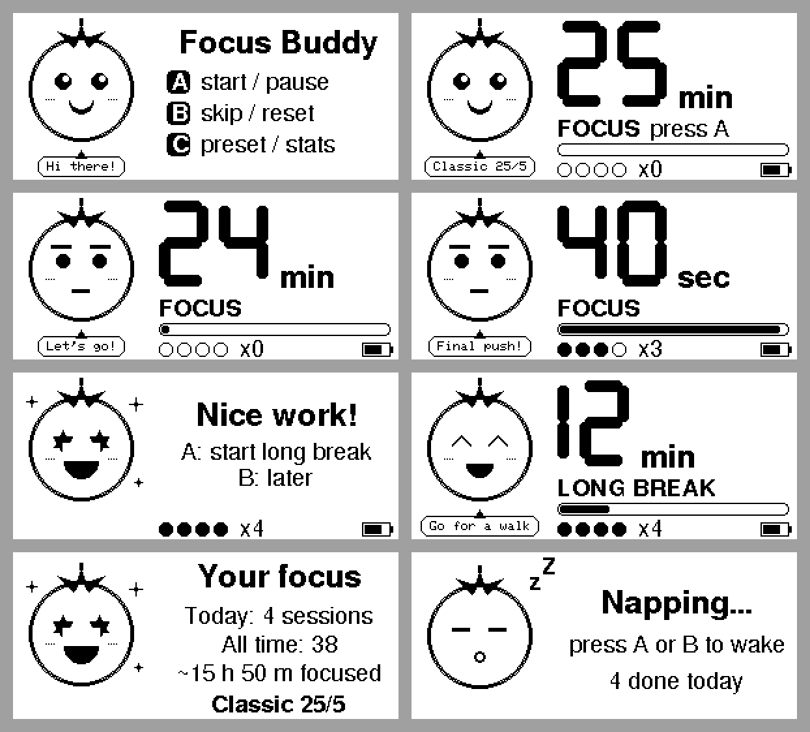
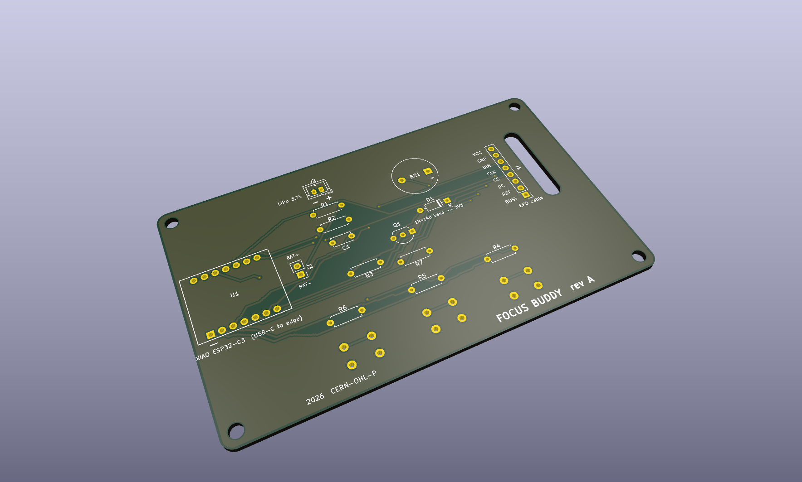
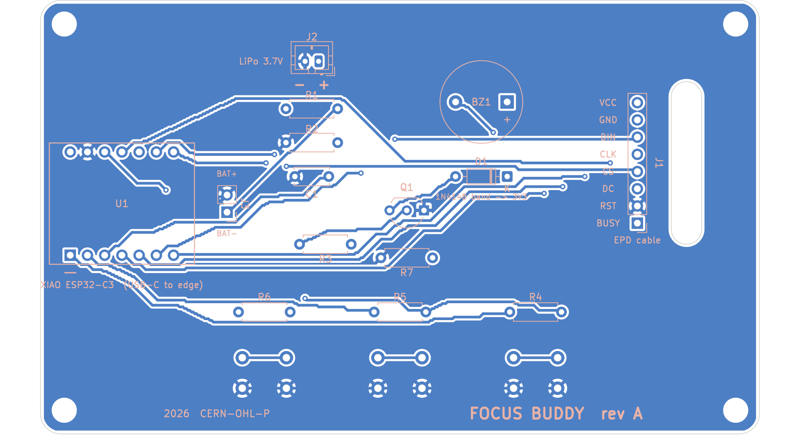
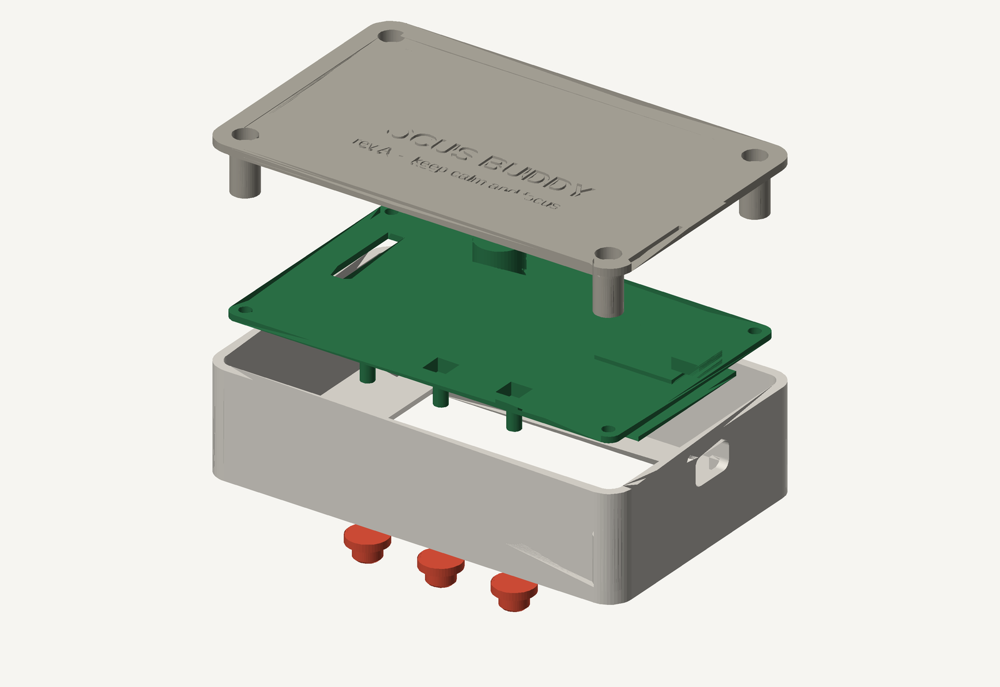
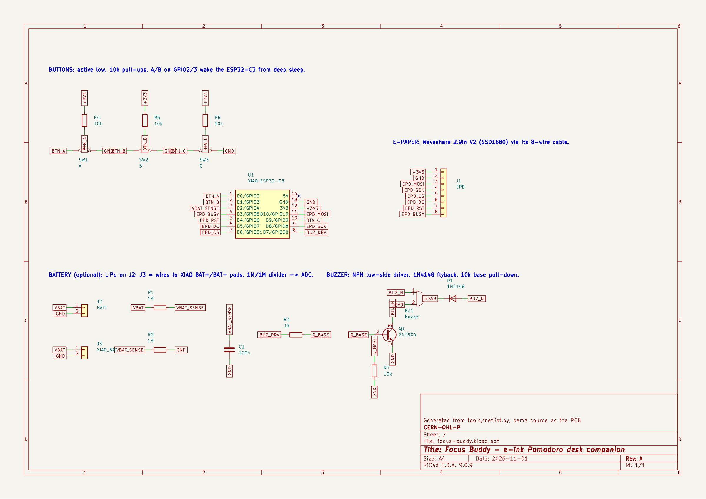
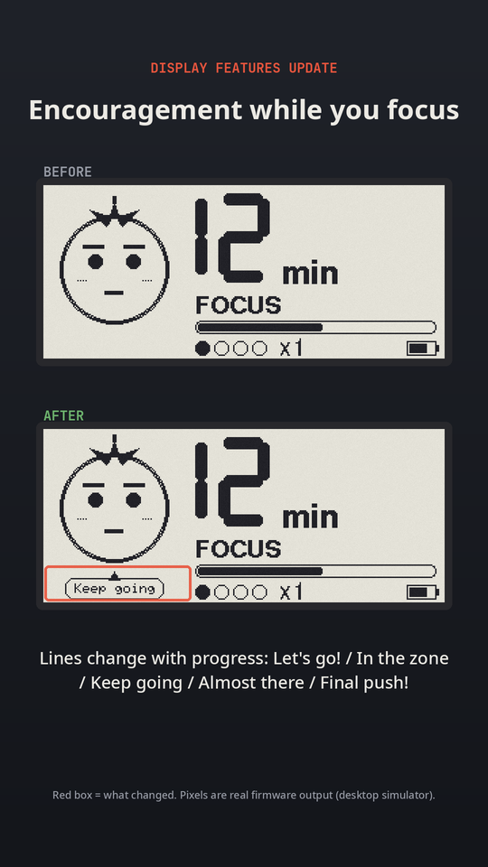

# Focus Buddy

An e-ink Pomodoro companion for your desk. A little tomato with a face counts down your focus blocks on a
2.9" e-paper screen, chimes when you're done, and naps when you walk away.

- **Seeed XIAO ESP32-C3** + **Waveshare 2.9" e-paper** (296×128)
- 3 buttons, buzzer, optional LiPo with battery gauge
- **All through-hole**, 18 parts, about 2 h to build
- Light sleep between screen updates; deep sleep (≈0.05 mA) after 3 min idle. E-ink keeps the image with zero power.

## Pictures

> No unit has been built yet, so these aren't photos. Each one comes straight from the project files:
> KiCad renders and exports, the real enclosure geometry, and screens drawn by the actual firmware in the desktop simulator.

**The screens:** every state, drawn by `firmware/src/ui.cpp`



**The PCB:** 106 × 64 mm, 2 layers, all through-hole (KiCad 3D render)



**Routing:** back copper layer, seen from behind (KiCad export)



**The case:** front shell, PCB, back cover and button caps, exploded (rendered from the OpenSCAD model)



**The schematic** (KiCad export)



**The buddy talks:** speech bubble added in the latest display update (before / after, real firmware output)



## What's in here

This repo holds **source files only**. Gerbers, STLs, STEP, PDFs, renders and videos are generated from them
(see "Generate the outputs" below) and are not committed.

| Path | What |
|---|---|
| [`docs/BUILD.md`](docs/BUILD.md) | **Start here.** Ordering, printing, soldering, flashing, assembly, troubleshooting |
| [`hardware/BOM.csv`](hardware/BOM.csv) | **Everything you need:** PCB parts, display, screws, printed parts, filament, solder, tools, software (generated by `tools/gen_bom.py`) |
| `tools/netlist.py` | **Single source of truth:** every part, net and its position on the board |
| `hardware/pcb/` | KiCad 9 project: `.kicad_pro`, `.kicad_sch`, `.kicad_pcb`, project symbol and footprint libraries |
| `hardware/cad/enclosure.scad` | Parametric OpenSCAD source of the case (front shell, back cover, button caps, stand) |
| `hardware/cad/pcb_positions.scad` | Hole and switch positions taken from the PCB (generated by `tools/gen_cad_params.py`) |
| `firmware/` | PlatformIO firmware (Arduino/ESP32, GxEPD2). All screen drawing is in `src/ui.cpp` |
| `sim/` | Desktop simulator: compiles `ui.cpp` for your PC and renders the real screens |
| `tools/` | `build_pcb.py` (place + ground pour), `route_pcb.py` (A* autorouter), `build_schematic.py`, `gen_bom.py`, `gen_cad_params.py`, `render_stl.py`, `make_all.sh` |
| `video/` | Scripts that render the progress reels and before/after clips from simulator output |

## Generate the outputs

```bash
tools/make_all.sh
```

This needs Docker (it uses the `kicad/kicad:9.0` and `openscad/openscad:2021.01` images) and runs at low priority on 1 CPU.
It writes:

| Output | Path |
|---|---|
| Gerbers + drill files (upload the zip to a PCB fab) | `hardware/fab/focus-buddy-gerbers.zip` |
| Schematic PDF | `hardware/fab/focus-buddy-schematic.pdf` |
| PCB STEP model, 3D renders, part positions | `hardware/fab/` |
| Printable STLs | `hardware/cad/stl/` |
| DRC / ERC reports | `hardware/pcb/*.rpt` |

## Quick start

```bash
# 1. firmware
cd firmware && pio run -t upload

# 2. preview the screens without hardware
pio run                       # once, to fetch the graphics library
../sim/build.sh
../sim/fbsim main 1 0 1 1380000 1500000 2 2 37 0 3900 "Classic 25/5" 25 /tmp/screen.pbm

# 3. regenerate all hardware outputs (docker; low priority, 1 CPU)
tools/make_all.sh
```

## Verification status

| Check | Result |
|---|---|
| Firmware build, 4 panel variants | ✅ compiles (≈23 % flash, 6 % RAM) |
| Schematic ERC | ✅ 0 errors |
| PCB DRC | ✅ 0 errors, 0 unconnected |
| Schematic ↔ PCB parity | ✅ 0 issues |
| Enclosure STLs | ✅ manifold (OpenSCAD "Simple: yes") |
| **Built and tested on real hardware** | ❌ **not yet.** Rev A is unbuilt; see the checklist in BUILD.md |

The repo-wide DRC/ERC reports also list "library not in global table" notes. Those come from the bare docker
image used for CI, not from the design.

## License

Suggested: hardware CERN-OHL-P v2, firmware and tools MIT. These were picked as sensible open defaults; change them before publishing if you prefer something else.
